LIVING PROFILE · 1DHAIRYAK · LIVE

<strong>Cloud &amp; Backend Engineer</strong>

I build full-stack cloud systems by day and play story-driven games by night.

<a href="https://github.com/1Dhairyak">GitHub</a> · <a href="https://linkedin.com/in/dhairya153">LinkedIn</a> · <a href="mailto:dhairyakumar490@gmail.com">Email</a>

✦ ─────────────── ✦

## Identity, with signal

<table><tr>
<td valign="top" width="70%">I build full-stack cloud systems by day and play story-driven games by night.  <b>Focus:</b> `Java / Spring Boot` · `AWS / Azure` · `C++ / DSA`  Cloud-native backends, serverless architectures, and distributed systems that hold up under load.</td>
<td valign="top"><code>LIVE SIGNAL</code>  <b>27</b> repositories <b>0</b> stars <b>323</b> contributions <b>0</b> followers</td>
</tr></table>

✦ ─────────────── ✦

## What moves the work

Positioning is useful when the proof is close behind it.

✦ ─────────────── ✦

## The tools behind the signal

JavaScript · Java · TypeScript · Python · HTML · CSS · Shell · Dockerfile · AWS · Azure · Spring Boot · React · Node.js — chosen for the work, not the trend

✦ ─────────────── ✦

## Built, shipped, shared

<table><tr><td valign="top" width="25%"><a href="https://github.com/1Dhairyak/Spotify-YouTube-music-visualizer-software"><b>music-visualizer</b></a>  Turns whatever you play on Spotify or YouTube Music into time-synced lyrics drawn as a glowing constellation.   JavaScript · ⭐ 0</td><td valign="top" width="25%"><a href="https://github.com/1Dhairyak/Nova-stack-Full-stack-space-data-dashboard-with-real-time-WebSocket-streaming"><b>nova-stack</b></a>  Nova is a real-time space operations dashboard — essentially a mission-control-style interface where a logged-  Java · ⭐ 0</td><td valign="top" width="25%"><a href="https://github.com/1Dhairyak/Stock-Price-Alert-System"><b>stock-alert</b></a>  Developed a backend system that tracks stock prices and sends automated email alerts when target price conditi  Java · ⭐ 0</td><td valign="top" width="25%"><a href="https://github.com/1Dhairyak/-N-Queens-Visualizer-description-"><b>n-queens</b></a>  A web-based visualizer for the N-Queens problem, built with HTML, CSS, and JavaScript. It demonstrates the bac  JavaScript · ⭐ 0</td></tr></table>

✦ ─────────────── ✦

## Momentum, made visible

✦ ─────────────── ✦

## The trail behind the work

1 day current streak · 71 active days

✦ ─────────────── ✦

KEEP THE SIGNAL MOVING

## Make something worth noticing

I like working with people who care about scale, clean architecture, and shipping the useful version.

<a href="https://github.com/1Dhairyak">GitHub</a> · <a href="https://linkedin.com/in/dhairya153">LinkedIn</a> · <a href="mailto:dhairyakumar490@gmail.com">Email</a> · <a href="https://instagram.com/dhairya_68">Instagram</a> · <a href="https://bsky.app/profile/dhairya">Bluesky</a>

Dhairya · refreshed daily from live GitHub data

